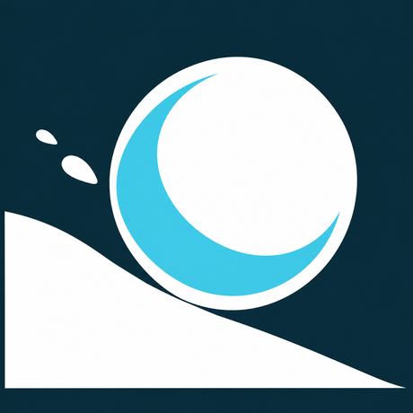

# drvlang

drvlang builds native lockfile projects with Nix. Each language has a CLI for working in a checkout and a flake interface for sharing its builds and tests. Read the [project overview](https://drvlang.org/) for a worked monorepo and CI example.

| Language | Builder | Dependency input |
| --- | --- | --- |
| Go | [drvgo](https://github.com/drvlang/drvgo) | Go modules |
| JavaScript and TypeScript | [drvjs](https://github.com/drvlang/drvjs) | pnpm |
| Python | [drvpy](https://github.com/drvlang/drvpy) | uv |
| Rust | [drvrust](https://github.com/drvlang/drvrust) | Cargo |
| Java | [drvjava](https://github.com/drvlang/drvjava) | rules_jvm_external Maven lock |
| C# and .NET | [drvnet](https://github.com/drvlang/drvnet) | NuGet packages.lock.json |
| C and C++ | [drvcpp](https://github.com/drvlang/drvcpp) | Meson wrap files |

Each builder's README describes its supported projects and platforms. The [shared contributor instructions](AGENTS.md) define the cross-language contract. [drvkit](https://github.com/drvlang/drvkit) contains shared implementations.
